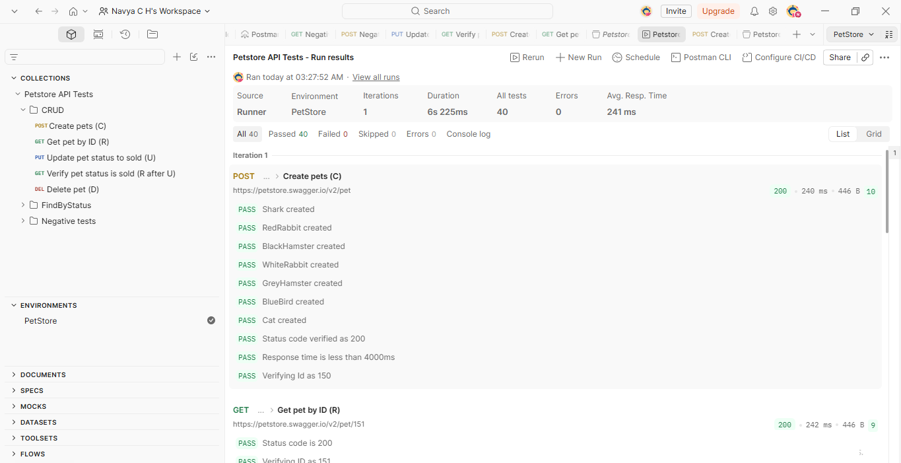
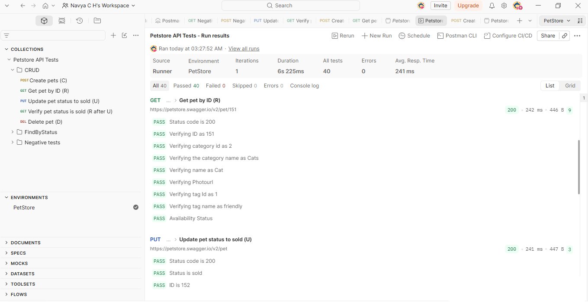
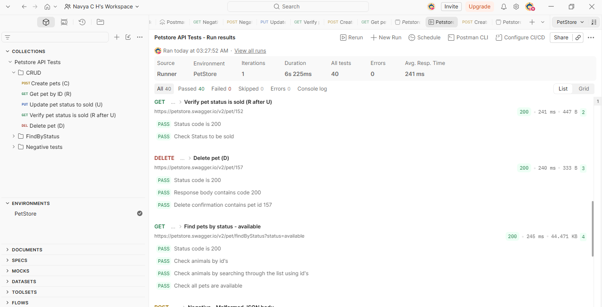
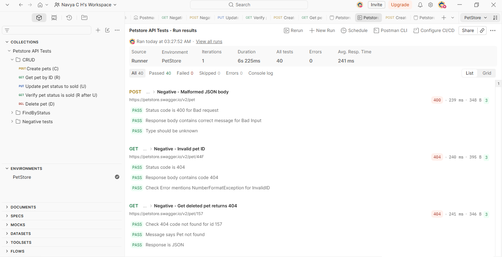

# Petstore API Tests (Postman)

A Postman collection that tests the public [Swagger Petstore](https://petstore.swagger.io) REST API. It covers create, read, update and delete operations, filtering by status, and negative scenarios, with 40 scripted assertions across 9 requests.

**Tools:** Postman (collection, environment variables, pre-request and test scripts)
**API under test:** `https://petstore.swagger.io/v2`
**Latest run:** 9 requests, 40 tests, 40 passed, 0 failed (about 6 s, average response time 241 ms)

## What is covered

| Area | What is checked |
|---|---|
| CRUD | Create pets, read a pet by ID, update a pet's status, verify the update, delete a pet |
| Find by status | List pets by status and check that every returned pet has that status |
| Negative tests | Malformed JSON body, invalid ID type, reading a deleted pet |
| Assertions | Status codes, response time, response fields, nested objects (`category`), arrays (`tags`, `photoUrls`), error messages, response headers |
| Scripting | Pre-request script that creates test data with `pm.sendRequest` and asserts each creation; environment variable `baseUrl` |

## Collection structure

```
Petstore API Tests
├── CRUD
│   ├── Create pets (C)
│   ├── Get pet by ID (R)
│   ├── Update pet status to sold (U)
│   ├── Verify pet status is sold (R after U)
│   └── Delete pet (D)
├── FindByStatus
│   └── Find pets by status - available
└── Negative tests
    ├── Negative - Malformed JSON body
    ├── Negative - Invalid pet ID
    └── Negative - Get deleted pet returns 404
```

Requests run top to bottom. Later requests depend on the data created by `Create pets`, and the last negative test depends on `Delete pet` having run first.

## Test scenarios

| # | Request | Method | Expected result |
|---|---|---|---|
| 1 | Create pets (C) | POST `/pet` | 200, response time under 4 s, pet 150 created. The pre-request script creates pets 151 to 157 and asserts a 200 for each |
| 2 | Get pet by ID (R) | GET `/pet/151` | 200, correct id, name, category (id and name), photoUrls, tag (id and name) and status |
| 3 | Update pet status to sold (U) | PUT `/pet` | 200, id is 152, status is `sold` |
| 4 | Verify pet status is sold (R after U) | GET `/pet/152` | 200, status is `sold` |
| 5 | Delete pet (D) | DELETE `/pet/157` | 200, response code 200, message contains the pet id |
| 6 | Find pets by status - available | GET `/pet/findByStatus?status=available` | 200, list contains my pets (150, 151, 153, 154), every pet is `available` |
| 7 | Negative - Malformed JSON body | POST `/pet` | 400, message "bad input", type "unknown" |
| 8 | Negative - Invalid pet ID | GET `/pet/44F` | 404, code 404, message mentions `NumberFormatException` |
| 9 | Negative - Get deleted pet returns 404 | GET `/pet/157` | 404, message "Pet not found", JSON content type |

## How to run

### In Postman
1. Import `collection/Petstore-API-Tests.postman_collection.json`.
2. Import `environment/PetStore.postman_environment.json` and select it in the top-right dropdown.
3. Click the collection, then **Run**, and run all requests in order.

The environment needs one variable:

| Variable | Value |
|---|---|
| `baseUrl` | `https://petstore.swagger.io/v2` |

### From the command line (optional)
```bash
npm install -g newman
newman run collection/Petstore-API-Tests.postman_collection.json -e environment/PetStore.postman_environment.json
```

## Results

All 40 tests pass across the 9 requests (Postman Collection Runner, list view).

**Create pets and read a pet**


**Get pet details and update status**


**Verify update, delete pet, and find by status**


**Negative tests**


## Findings

Things I noticed while testing the API:

- **Shared data changes between runs.** Petstore is a public demo server, so pets created by one run can be deleted or overwritten by other users later. To keep results consistent, each run creates its own test data first and the requests run in a fixed order.
- **Response time varies.** Responses from the shared server were sometimes slow, so the response-time check uses a 4 s limit instead of a tight one.
- **Invalid ID returns 404, not 400.** `GET /pet/44F` returns a 404 with a raw Java `NumberFormatException` message. A malformed ID would normally be a 400, and internal exception text should not be exposed to clients.
- **Optional fields are missing on some pets.** In the `findByStatus` list, some pets have no `name` or no `category`, so tests should not assume every field exists.

## Repository layout

```
.
├── collection/
│   └── Petstore-API-Tests.postman_collection.json
├── environment/
│   └── PetStore.postman_environment.json
├── screenshots/
│   ├── collection-runner-1.png
│   ├── collection-runner-2.png
│   ├── collection-runner-3.png
│   └── collection-runner-4.png
└── README.md
```

## Author

Navya C H, QA Engineer
[LinkedIn](www.linkedin.com/in/navya-c-h-b400a2219) | [GitHub](https://github.com/navyach21)
